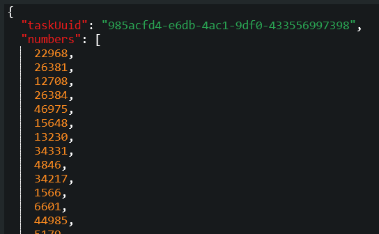
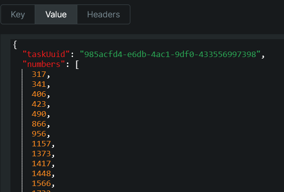
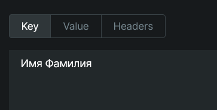

# Kafka-race

#### Классы для удобной работы:
- Задача, которую необходимо считать из топика - [TaskDto](src/main/java/ru/liga/kafkataskclient/core/dto/TaskDto.java)
- Ответ, который вы должны положить в топик для обработки сервером - [AnswerDto](src/main/java/ru/liga/kafkataskclient/core/dto/TaskDto.java)
- Интерфейс для отправки сообщения в кафку - [MessageProducer](src/main/java/ru/liga/kafkataskclient/kafka/MessageProducer.java)

#### Задача №1 – Сортировка чисел

    Получение задачи:
        Слушайте топик in-task-1-sort-numbers-topic для получения задач.

    Сортировка:
        Получите массив numbers из сообщения.
        Отсортируйте массив.

    Отправка ответа:
        Отправьте ответ в out-answer-task-1-topic с:
            Key: Фамилия и имя (одинаковое для всех задач, нужно для идентификации вас в системе).
            Value: 
                UUID задачи (остается тем же, что и в полученной задаче для проверки ответа на сервере),
                Полученный массив после сортировки

#### Задача №2 – Поиск простых чисел

    Получение задачи:
        Слушайте топик in-task-2-prime-numbers-topic для получения задач.

    Поиск простых чисел:
        Найдите все простые числа в массиве numbers.

    Отправка ответа:
        Отправьте ответ в out-answer-task-2-topic с:
            Key: Фамилия и имя (одинаковое для всех задач, нужно для идентификации вас в системе).
            Value: 
                UUID задачи (остается тем же, что и в полученной задаче для проверки ответа на сервере),
                Полученный массив простых чисел

#### Задача в топике

#### Должно быть в топиках для ответов

